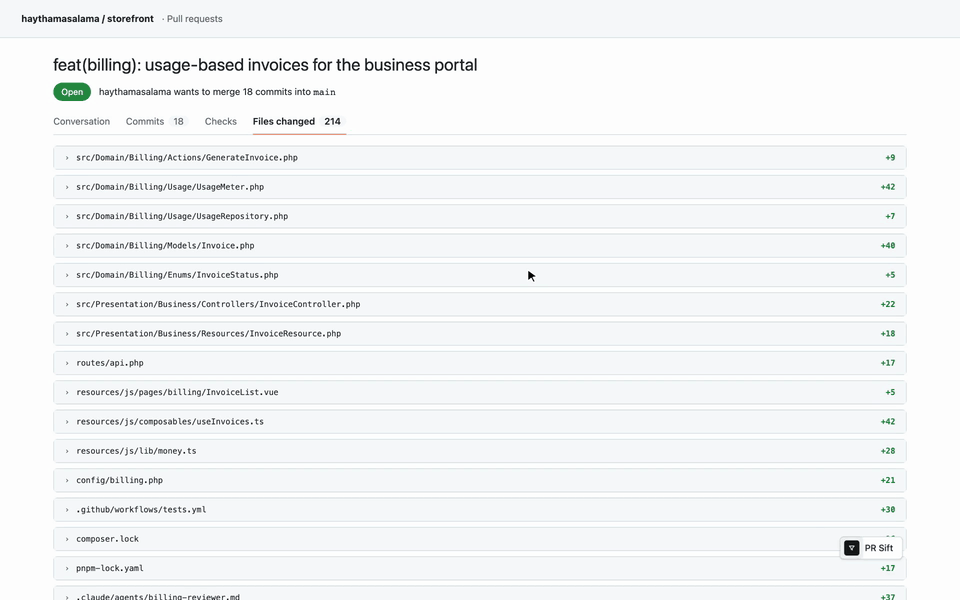
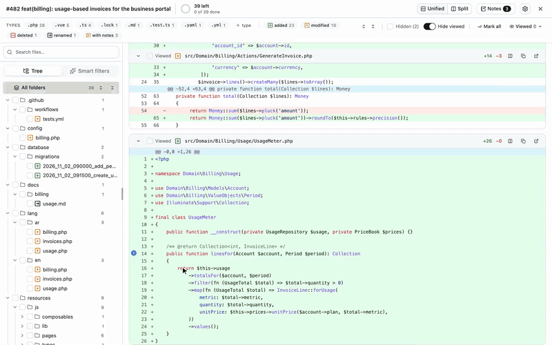
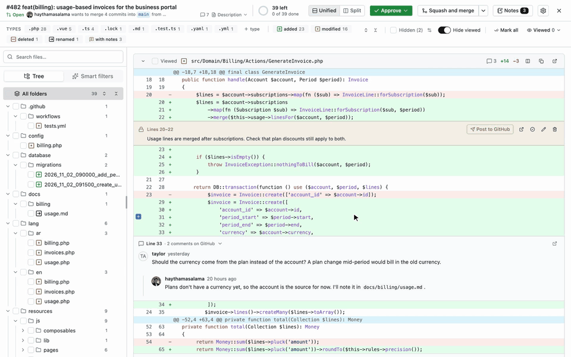
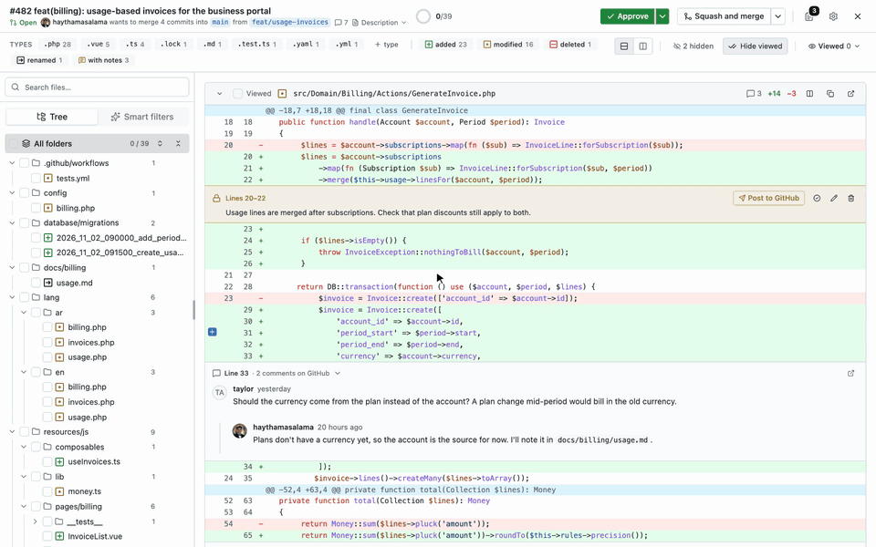
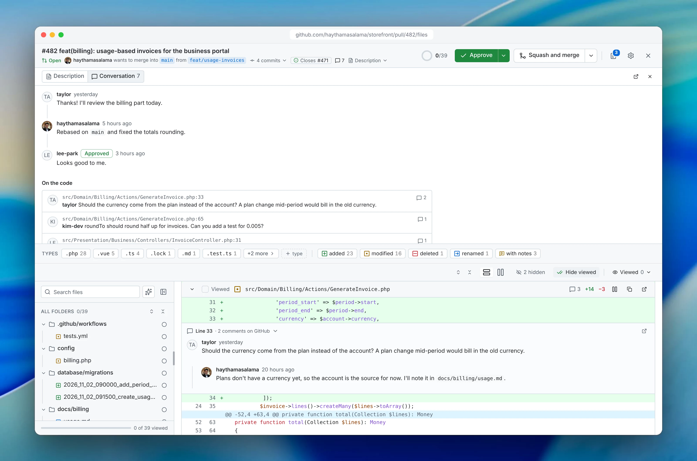

<p align="center">
  
</p>

<h1 align="center">PR Sift</h1>

<p align="center"><strong>Review large GitHub pull requests without the noise.</strong></p>

<p align="center">
  <a href="https://chromewebstore.google.com/detail/pr-sift/kdbgdnoafohnnojmoaaabdomgfigdhln"><strong>🧩 Add to Chrome, it’s free</strong></a> ·
  <a href="https://pr-sift.haythamasalama.me/">🌐 Website</a> ·
  <a href="docs/USAGE.md">📖 Guide</a> ·
  <a href="CHANGELOG.md">📝 Changelog</a>
</p>

<p align="center">
  <a href="https://github.com/haythamasalama/pr-sift/actions/workflows/ci.yml"></a>
  <a href="https://github.com/haythamasalama/pr-sift/releases/latest"></a>
  <a href="LICENSE"></a>
</p>

```diff
- Scroll 214 changed files.
+ Review the 12 that matter.
```

<picture>
  <source media="(prefers-color-scheme: dark)" srcset="media/videos/before-after-dark.gif" />
  
</picture>

Cut a pull request down to the files that matter, and keep notes only you can see. Send them to your AI, or post them
when you choose.

## ✨ What it does

### 🗒️ Write notes on the code. Your AI fixes them.

Write on any lines while you review. Notes stay in your browser until you decide otherwise. Copy them as one prompt for
Claude Code, Codex, Cursor, Copilot, Claude or ChatGPT, resolve what got fixed, or post one to GitHub.

<picture>
  <source media="(prefers-color-scheme: dark)" srcset="media/videos/notes-dark.gif" />
  
</picture>

### 🔀 Merge without AI co-authors

```diff
- Co-authored-by: Claude <noreply@anthropic.com>
+ Your name on your commit.
```

Approve, then squash and merge from the review. Claude, ChatGPT, Gemini, Copilot and other AI tools start unchecked, so
they stay out of your history unless you keep them.

<picture>
  <source media="(prefers-color-scheme: dark)" srcset="media/videos/merge-dark.gif" />
  
</picture>

### 🔍 Find the files that matter

Click a type or change to show only that. Shift-click hides it on every pull request. Open or close whole folders, or
jump straight to tests, migrations, translations, config and CI.

<picture>
  <source media="(prefers-color-scheme: dark)" srcset="media/videos/filters-dark.gif" />
  
</picture>

### ✅ Read each file once

Mark files or whole folders as viewed and they leave the list. The ring shows what is left, and a new push brings
changed files back.

<picture>
  <source media="(prefers-color-scheme: dark)" srcset="media/videos/review-dark.gif" />
  
</picture>

### 💬 Comments where the code is

GitHub threads show under their lines, and the conversation opens above the files. No trip back to GitHub.

<picture>
  <source media="(prefers-color-scheme: dark)" srcset="media/screenshots/comments-dark.webp" />
  
</picture>

### 🧰 And more

- 🪟 Unified or split diffs, for every file or just one
- 📋 Copy a file's name, path, diff or added lines
- 📄 The pull request description one click away
- 🔖 Saved filters as buttons beside the file types
- ⚙️ Settings in a side sheet, opened right where you need them
- ⚡ Pull requests that open straight in PR Sift, if you want
- 🌓 Light, dark or your system's theme

See them all on the [website](https://pr-sift.haythamasalama.me/).

## 📦 Install

Add PR Sift from the [Chrome Web Store](https://chromewebstore.google.com/detail/pr-sift/kdbgdnoafohnnojmoaaabdomgfigdhln),
then open any pull request on github.com and press **PR Sift** at the bottom right. It works in Chrome and Chromium
browsers such as Edge, Brave, Arc, Dia, Opera and Vivaldi.

### 🔑 Connect GitHub (optional)

Filtering, viewed files and notes work without a token. To approve, comment, post notes and merge from the review, open
Settings › GitHub and press **Create a token**. GitHub opens a classic token named PR Sift with the `repo` scope checked.
Create it and paste it back in PR Sift.

### 🛠️ Install by hand

1. Download `pr-sift-<version>.zip` from the [latest release](https://github.com/haythamasalama/pr-sift/releases/latest)
   and unzip it.
2. Open `chrome://extensions`, turn on **Developer mode**, choose **Load unpacked** and select the unzipped folder.
3. Open any pull request on github.com and press **PR Sift** at the bottom right.

To build it from source, run the commands below and load `apps/extension` the same way:

```bash
git clone https://github.com/haythamasalama/pr-sift.git
cd pr-sift
pnpm install
pnpm build
```

What changed in each version is in the [changelog](CHANGELOG.md), and the [guide](docs/USAGE.md) covers every action and
setting.

## 🔒 Privacy

Your code stays in your browser. PR Sift talks only to GitHub, stores filters, viewed marks and notes locally, and has
no server, account or analytics. A GitHub token is optional. Details in [PRIVACY.md](PRIVACY.md).

## 🤝 Contributing

How it works is in [docs/ARCHITECTURE.md](docs/ARCHITECTURE.md), and how to help is in [CONTRIBUTING.md](CONTRIBUTING.md).

## ⚖️ License

[MIT](LICENSE): free and open source. Use it, change it and share it. Not affiliated with GitHub.

Copyright © 2026 [Haytham A. Salama](https://haythamasalama.me/).
