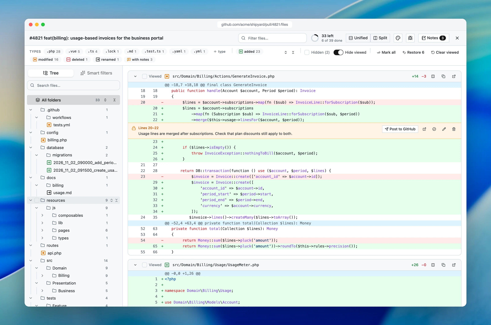
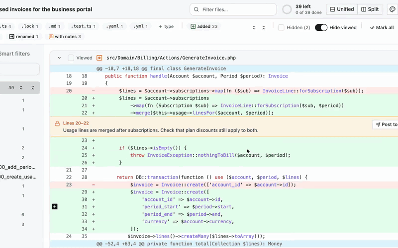
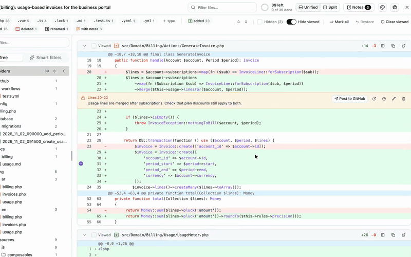
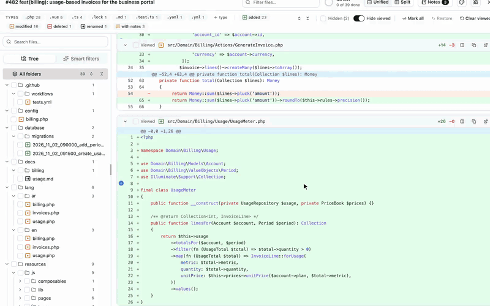

<p align="center">
  
</p>

<h1 align="center">PR Sift</h1>

<p align="center"><strong>Review large GitHub pull requests without the noise.</strong></p>

<p align="center">
  <a href="https://pr-sift.haythamasalama.me/">Website</a> ·
  <a href="#install">Install</a> ·
  <a href="docs/USAGE.md">Guide</a> ·
  <a href="https://github.com/haythamasalama/pr-sift/issues/new/choose">Report a problem</a>
</p>

<p align="center">
  <a href="https://github.com/haythamasalama/pr-sift/actions/workflows/ci.yml"></a>
  <a href="https://github.com/haythamasalama/pr-sift/releases/latest"></a>
  <a href="LICENSE"></a>
</p>



A free Chrome extension that turns a long GitHub pull request into a focused review.

## What it does

### Show only the files you want

Click a type or change to show it. Shift-click to hide it for good.



### Never read a file twice

Mark files or whole folders as viewed. A new push brings changed files back.



### Private notes for your AI

Notes only you see. Copy them for Claude Code, Codex, Cursor or ChatGPT, or post one to GitHub.



### And the small things

- 🧩 Smart filters for tests, migrations, translations, config and CI
- 🪟 Split or unified diffs, for every file or just one
- 📋 Copy a file's name, path, diff or added lines
- 🤖 Claude Code, Codex, Cursor, Copilot, Claude or ChatGPT
- 🌓 Light, dark or system theme

See them all on the [website](https://pr-sift.haythamasalama.me/).

## Install

PR Sift is on its way to the Chrome Web Store. Until then:

1. Download `pr-sift-<version>.zip` from the [latest release](https://github.com/haythamasalama/pr-sift/releases/latest)
   and unzip it.
2. Open `chrome://extensions`, turn on **Developer mode**, choose **Load unpacked** and select the unzipped folder.
3. Open any pull request on github.com and press **PR Sift** at the bottom right.

To build it from source instead, run the commands below and load `apps/extension` the same way:

```bash
git clone https://github.com/haythamasalama/pr-sift.git
cd pr-sift
pnpm install
pnpm build
```

What changed in each version is in the [changelog](CHANGELOG.md).

Works in Chrome and Chromium browsers such as Edge, Brave, Arc and Dia. See the [guide](docs/USAGE.md) for every
action and setting.

## Privacy

Your code stays in your browser. PR Sift talks only to GitHub, stores filters, viewed marks and notes locally, and has
no server, account or analytics. A GitHub token is optional. Details in [PRIVACY.md](PRIVACY.md).

## Contributing

- 🌐 How it works: the [website](https://pr-sift.haythamasalama.me/)
- 🛠️ How to help: [CONTRIBUTING.md](CONTRIBUTING.md)

## License

[PolyForm Shield 1.0.0](LICENSE): free to use, including at work. You may not sell PR Sift or publish a copy or a competing product. Not affiliated with GitHub.

Copyright © 2026 Haytham A. Salama.

## Author

<a href="https://haythamasalama.me/">
  <picture>
    <source media="(prefers-color-scheme: dark)" srcset="media/brand/haythamasalama-signature-white.svg" />
    
  </picture>
</a>

Made by **Haytham A. Salama**, senior software engineer.

- 🌐 [haythamasalama.me](https://haythamasalama.me/)
- 𝕏 [@haythamasalama](https://x.com/haythamasalama)
- 💼 [LinkedIn](https://www.linkedin.com/in/haythamasalama)
- 🐙 [GitHub](https://github.com/haythamasalama)
