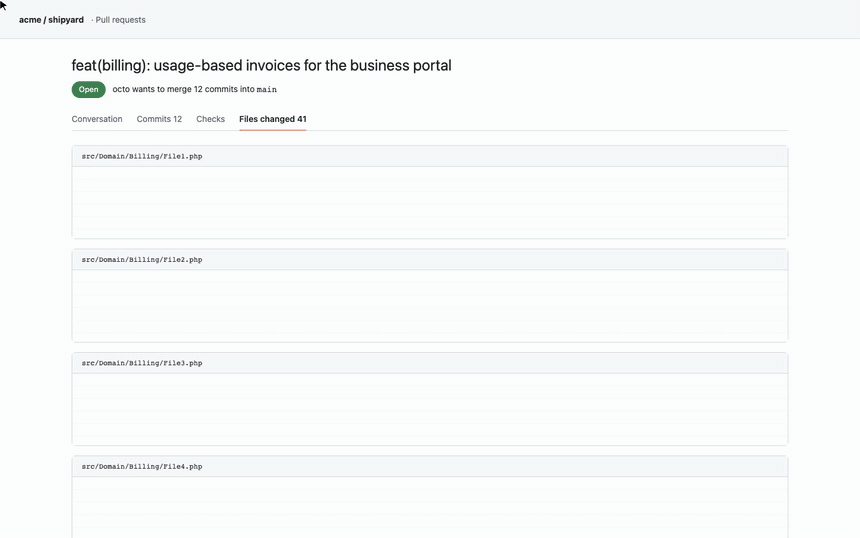
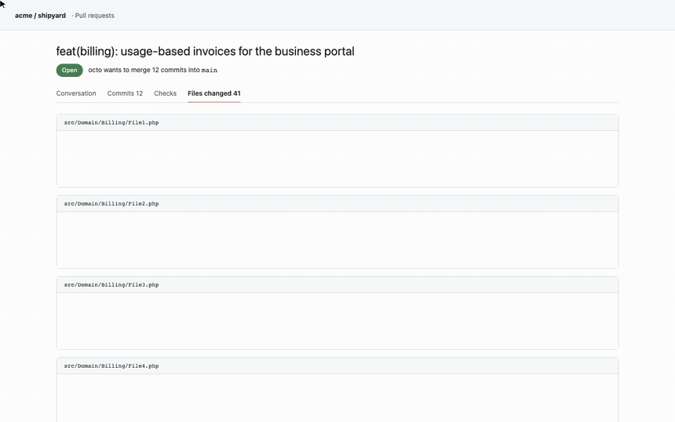
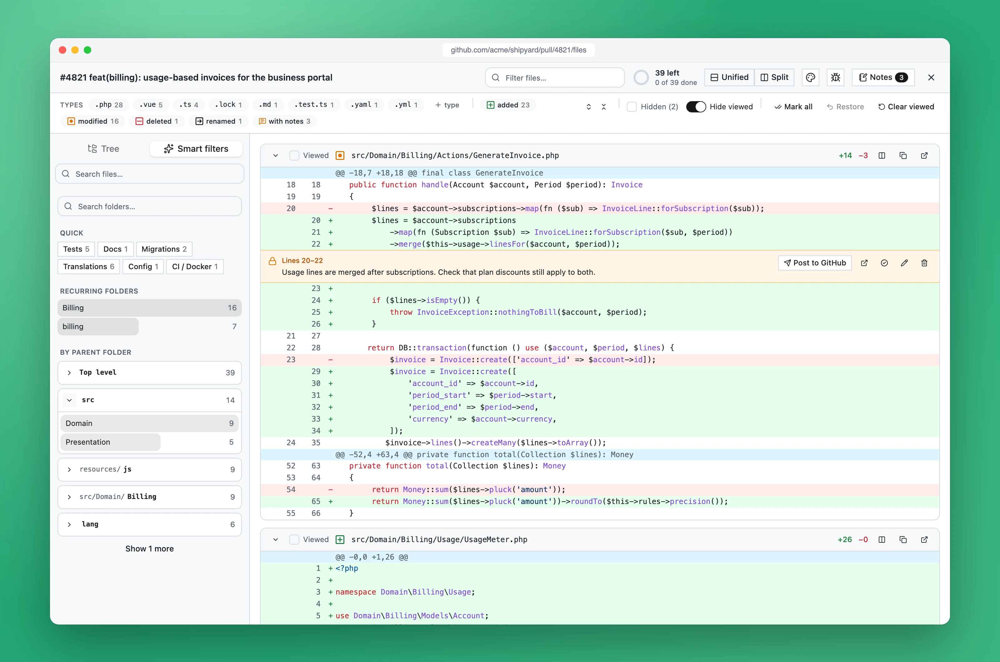
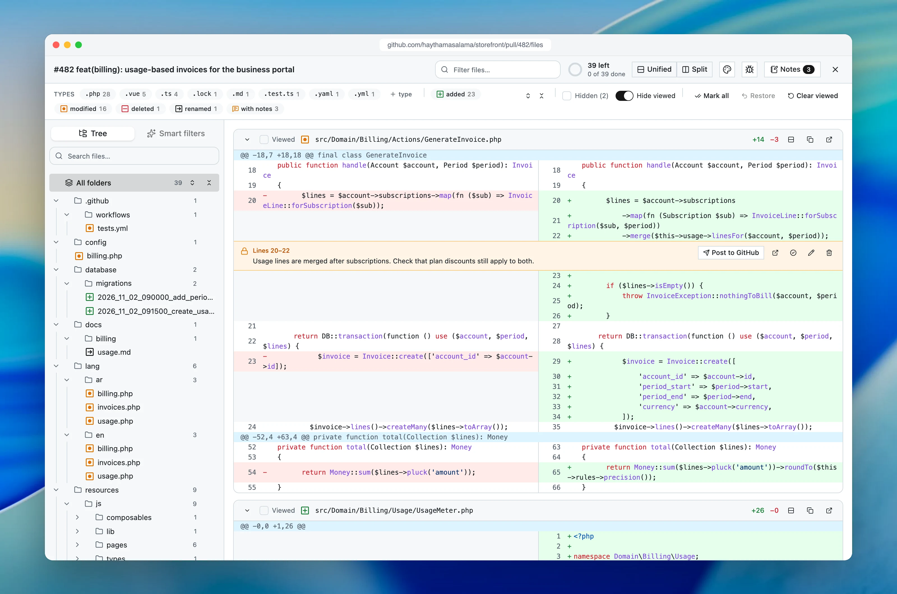
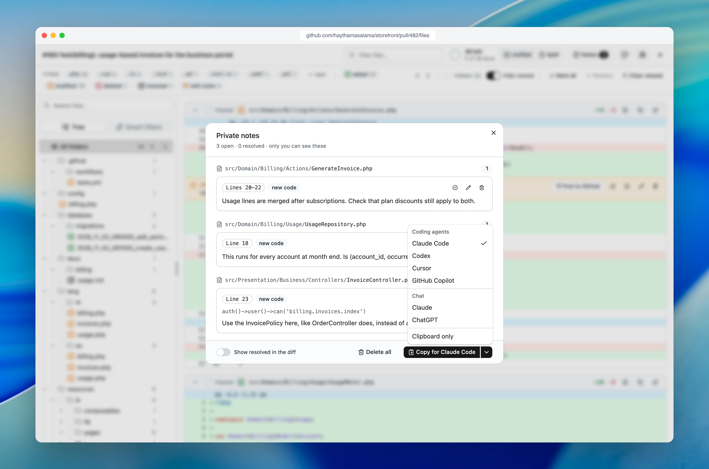
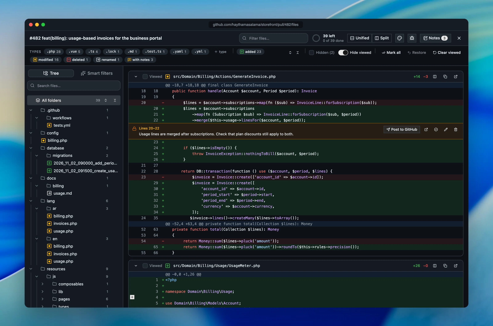

<p align="center">
  
</p>

<h1 align="center">PR Sift</h1>

<p align="center"><strong>Review large GitHub pull requests without the noise.</strong></p>

<p align="center">
  <a href="https://haythamasalama.github.io/pr-sift/">Website</a> ·
  <a href="#install">Install</a> ·
  <a href="docs/USAGE.md">Guide</a> ·
  <a href="https://github.com/haythamasalama/pr-sift/issues/new/choose">Report a problem</a>
</p>

<p align="center">
  <a href="https://github.com/haythamasalama/pr-sift/actions/workflows/ci.yml"></a>
  <a href="LICENSE"></a>
</p>


Pull requests keep getting bigger, and AI agents now open them with hundreds of files. GitHub shows everything in one
long list, so the ten files that matter hide between lock files, translations and renames. PR Sift is a free,
open-source Chrome extension that turns that list into a focused review.

## What it does

### Show exactly the files you want

Chips come from the pull request itself. Click `.php` to see only PHP, add `added` to see only new PHP files,
shift-click `.lock` to hide lock files for good. Add your own types such as `.blade.php` or `.test.ts`.



### Never read the same file twice

Mark a file or a whole folder as viewed and it leaves the list. A ring shows what is left. Marks follow the file
content, so a file that changes after a new push comes back by itself. Collapse or expand any folder and everything
inside it.



### Private notes, sent to the AI you use

Drag over lines to write a note only you can see. Resolve notes as you go, post one to GitHub when it is worth it, or
copy them all with their code as a ready prompt for **Claude, ChatGPT or Gemini**.


### And the small things

| Smart filters                                          | Split one file, copy anything               |
| ------------------------------------------------------ | ------------------------------------------- |
|  |  |
| **Choose your assistant**                              | **Light and dark**                          |
|       |    |

## Install

PR Sift is on its way to the Chrome Web Store. Until then, install it from source:

```bash
git clone https://github.com/haythamasalama/pr-sift.git
cd pr-sift
pnpm install
pnpm build
```

Open `chrome://extensions`, turn on **Developer mode**, choose **Load unpacked** and select `apps/extension`. Then
open any pull request on github.com and press **PR Sift** at the bottom right.

Works in Chrome and Chromium browsers such as Edge, Brave, Arc and Dia. See the [guide](docs/USAGE.md) for every
action and setting.

## Privacy

Your code stays in your browser. PR Sift talks only to GitHub, stores filters, viewed marks and notes locally, and has
no server, account or analytics. A GitHub token is optional. Details in [PRIVACY.md](PRIVACY.md).

## Contributing

Ideas, bug reports and pull requests are welcome, and small ones count.

- **Found a bug or have an idea?** [Open an issue](https://github.com/haythamasalama/pr-sift/issues/new/choose).
- **Want to code?** Read [CONTRIBUTING.md](CONTRIBUTING.md) and [docs/ARCHITECTURE.md](docs/ARCHITECTURE.md), then
  run `pnpm check`. The pure logic lives in `packages/core` and is the easiest place to start.
- **Using an AI coding agent?** [AGENTS.md](AGENTS.md) and the skills in `.claude/skills` explain the project's rules.

```
apps/extension    the Chrome extension (Vue 3, Vite, Tailwind, shadcn-vue)
apps/site         the website
packages/core     diff parsing, file tree, smart filters, notes. No browser APIs
tools/capture     regenerates every screenshot and video in this README
```

## License

[MIT](LICENSE). Not affiliated with GitHub.
