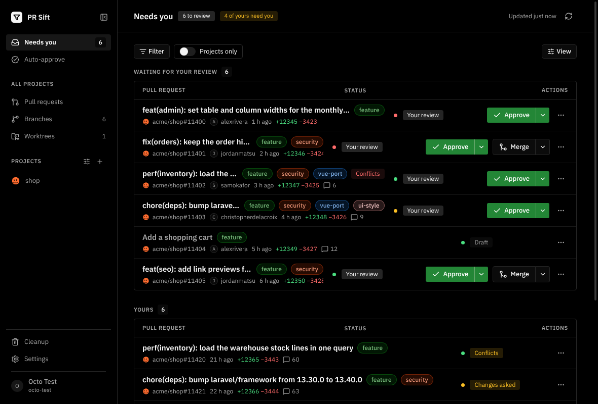
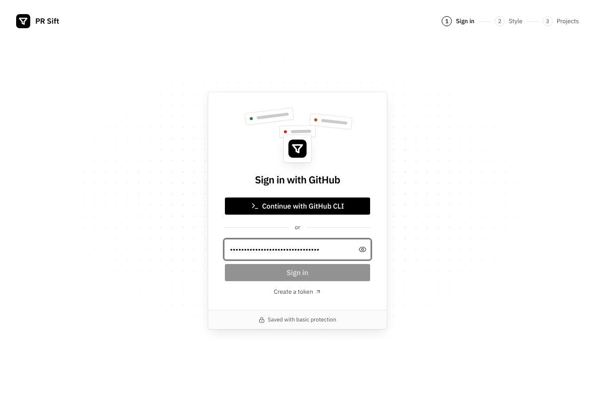
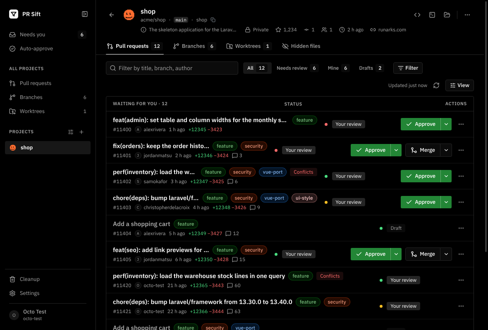
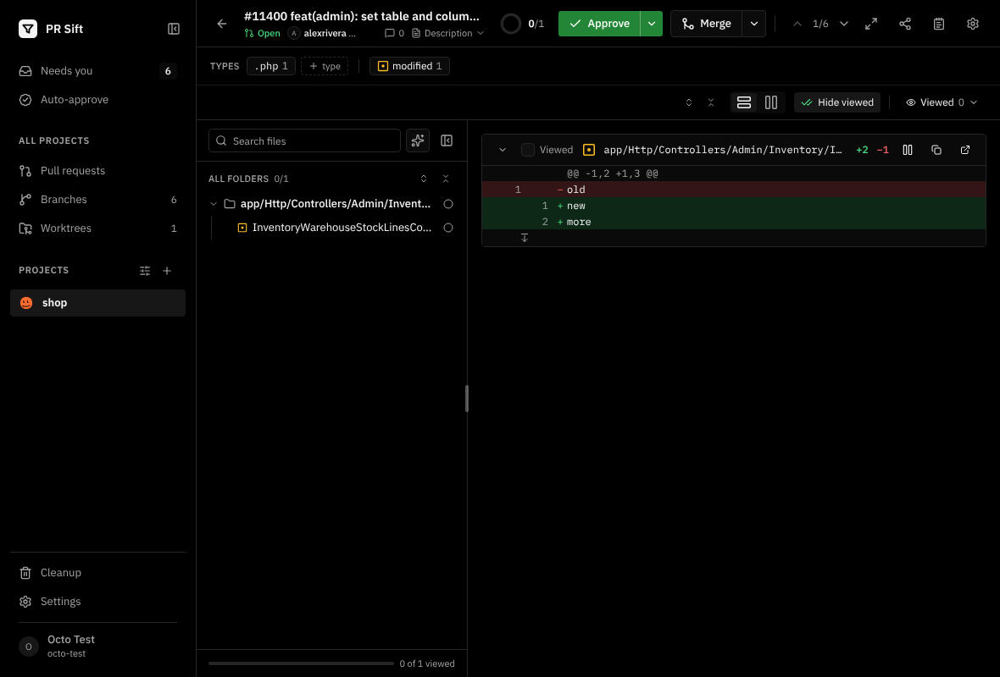
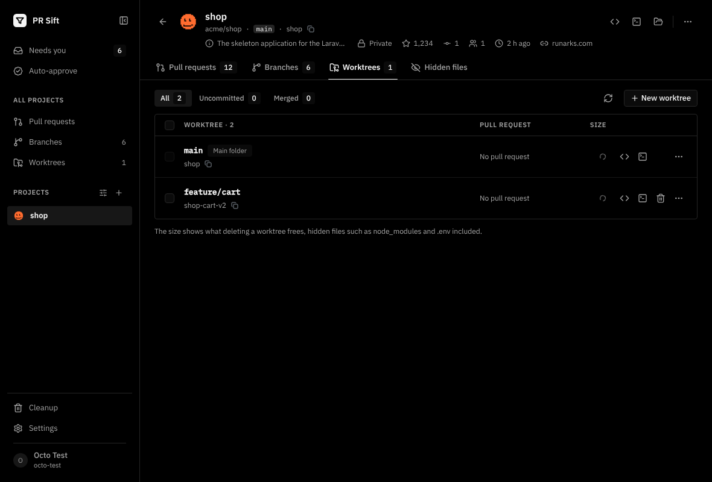
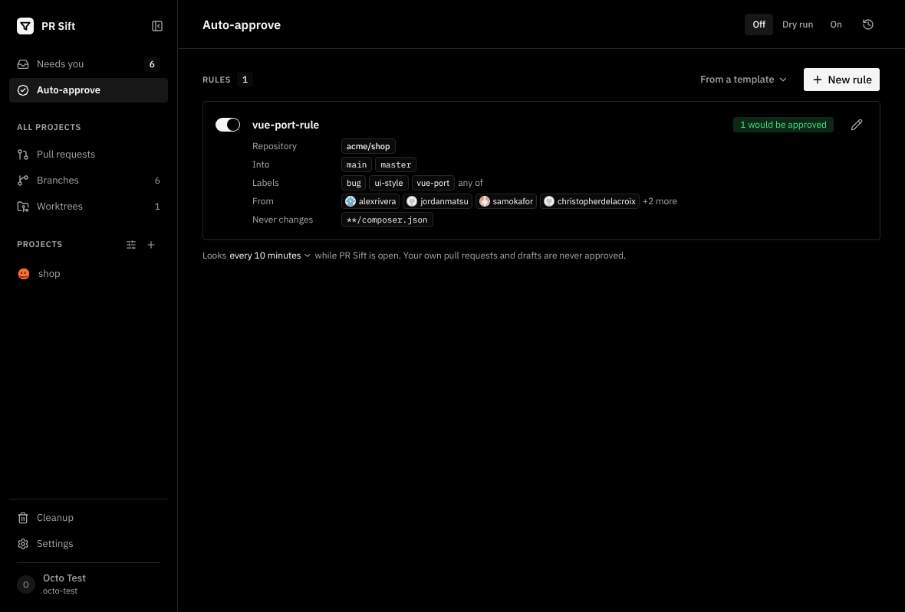
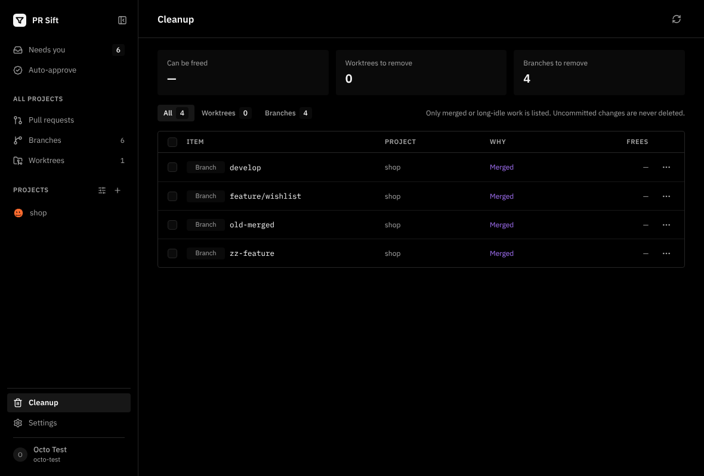

# PR Sift desktop

An Electron app for macOS, Windows and Linux, in beta. It brings the PR Sift review out of the browser and adds what a
browser extension cannot do: your local repositories, their branches and worktrees.

- **Needs you** lists the pull requests waiting for your review and your own that need you, across every repository.
- **Projects** are your local repositories. Each one has its pull requests, branches, worktrees and hidden files.
- **All projects** shows the pull requests, branches and worktrees of every project on one page.
- **Review** opens a pull request in the same review UI as the extension, with Approve and Merge always in one place.
- **Auto-approve** approves pull requests that match your rules, with a dry run first.
- **Cleanup** finds merged or idle branches and worktrees, and heavy folders you can rebuild.



## Run it

```bash
pnpm install
pnpm desktop:dev          # from the repository root
```

## Build an installer

```bash
pnpm --filter @pr-sift/desktop dist:mac     # .zip of the .app (run on a Mac for a .dmg)
pnpm --filter @pr-sift/desktop dist:win     # NSIS installer (run on Windows)
pnpm --filter @pr-sift/desktop dist:linux   # AppImage and .deb
```

Builds are not notarized yet. On a Mac, an unsigned app built elsewhere needs an ad-hoc signature before it opens:

```bash
xattr -cr "PR Sift.app" && codesign --force --deep --sign - "PR Sift.app"
```

## How it is put together

- `src/main` runs in Electron's main process. It holds the GitHub token (encrypted with `safeStorage`), sends every
  GitHub request, runs git, measures folders and moves things to the Trash. Only paths found by the last scan can be
  removed.
- `src/preload` exposes one bridge, `window.prSift`, with a fixed list of channels (`src/shared/ipc.ts`).
- `src/renderer` is the Vue app. It reuses the extension's components and styles through the `@` alias, and installs a
  `chrome` shim (`shim/chrome.ts`) so extension code that calls `chrome.storage` and `chrome.runtime.sendMessage` runs
  unchanged.

## Screenshots

|                                                    |                                                              |
| -------------------------------------------------- | ------------------------------------------------------------ |
|            |  |
|              |          |
|  |                      |

All screenshots use sample data from the end-to-end tests.

## Tests

```bash
pnpm --filter @pr-sift/desktop test     # unit and git integration tests
pnpm --filter @pr-sift/desktop build && node apps/desktop/tests/e2e/smoke.mjs <projects folder> [screenshots folder]
```

The smoke run launches the built app with a throwaway profile and a stubbed GitHub, and walks through every screen.
On Linux without a display, wrap it in `xvfb-run -a`.
